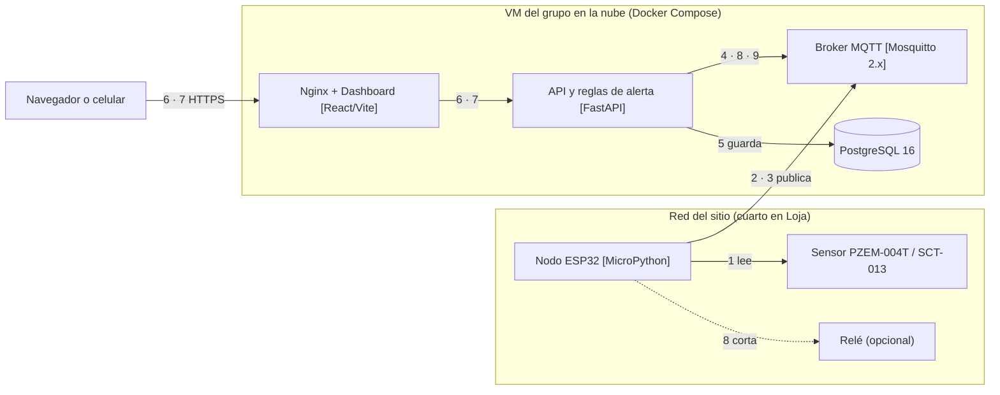

# Submedición eléctrica IoT para arriendos en Loja
 
Sistema para medir el consumo eléctrico de cada cuarto o departamento de arriendo, mostrar la planilla estimada por inquilino y avisar cuando el consumo se sale de lo normal.
 
Proyecto integrador de Tecnologías Emergentes, UIDE Loja, semestre octubre 2026 a febrero 2027.
 
## El problema
 
En Loja hay muchos cuartos y minidepartamentos de arriendo que comparten un solo medidor. Como nadie sabe cuánto gasta cada inquilino, el dueño reparte la planilla por partes iguales o "a ojo", y eso termina en discusiones. Tampoco hay datos de cuándo se consume, así que un equipo olvidado encendido o una fuga pasan desapercibidos hasta que llega la planilla.
 
## Qué hace el sistema
 
- Un nodo ESP32 por cuarto mide voltaje, corriente, potencia y energía (kWh).
- Los nodos publican las lecturas por MQTT a un broker en la nube.
- Un backend guarda el historial y calcula el consumo de cada inquilino.
- El dashboard muestra el consumo, la planilla estimada (kWh medidos por la tarifa vigente, repartidos según lo que gastó cada uno) y las alertas.
- Las alertas cubren consumo muy por encima del patrón del cuarto, consumo continuo de noche y consumo anormal sostenido.
- Un relé opcional permite cortar o reactivar un circuito.
## Arquitectura
 

 
Las flechas salen de quien inicia la conexión y el número corresponde al flujo de la tabla.
 
| N.° | Flujo | Origen y destino | Protocolo |
|:--:|---|---|---|
| 1 | Medición | Nodo → sensor | UART (Modbus-RTU) |
| 2 | Telemetría | Nodo → broker | MQTTS, puerto 8883, QoS 1 |
| 3 | Estado del nodo | Nodo → broker | MQTTS, puerto 8883, retenido con Will |
| 4 | Ingesta | Backend → broker | MQTT, puerto 1883 (red interna) |
| 5 | Persistencia | Backend → PostgreSQL | SQL, puerto 5432 (red interna) |
| 6 | Consulta y alertas | Navegador → API | HTTPS, puerto 443 |
| 7 | Administración | Navegador → API | HTTPS, puerto 443 |
| 8 | Órdenes de relé (opcional) | Backend → nodo → relé | MQTTS, puerto 8883 y GPIO |
| 9 | Configuración | Backend → nodo | MQTTS, puerto 8883, retenido |
 
Según los niveles de despliegue de Bahga y Madisetti, el sistema es de nivel 6: varios nodos independientes que envían sus datos directo a la nube, donde se guardan, se analizan y se muestran.
 
## Decisiones de arquitectura
 
- **ADR-001:** MQTT con un broker Mosquitto propio para la telemetría.
- **ADR-002:** enviar la energía acumulada (kWh) y guardar lecturas en el nodo cuando se corta la red, para que perder mensajes no cambie el total del mes.
## Tecnologías
 
| Parte | Tecnología |
|---|---|
| Nodo | ESP32, MicroPython, PZEM-004T v3 o SCT-013 |
| Mensajería | MQTT 3.1.1, Mosquitto 2.x, TLS |
| Backend | Python, FastAPI |
| Base de datos | PostgreSQL |
| Dashboard | React, Vite |
| Despliegue | Docker Compose, Nginx |
 
## Contenido del repositorio
 
```text
docs/
└── arquitectura/
    ├── GTA_S4_arquitectura.drawio
    └── GTA_S4_Grupo_Martinez.pdf
```
 
## Equipo
 
- Wilson Martínez
- Iván Peralta
Docente: Richard Armijos.
 
Es un prototipo académico: no reemplaza a un medidor certificado y la conexión a la red eléctrica solo se hace en un circuito propio y con las precauciones necesarias.
 
